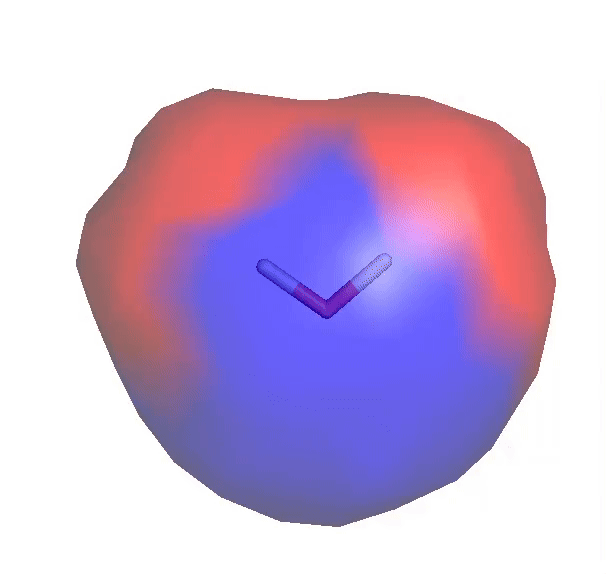

# EMSuite - Electrostatic Map Suite

A Python package for electrostatic tuning maps, APBS potential surfaces, and coupled
potential→tuning workflows on molecular systems.





**Figure 1:** Tuning effects of a +1 *e* charge on the S<sub>1</sub> excitation energy of water, calculated at the B3LYP/cc-pVTZ level in vacuum.


## Overview

EMSuite qualifies and quantifies how external electrostatic environments shift
electronic structure. Four channels work together:

| Channel | CLI | Role |
|---------|-----|------|
| **Surface** | `emsuite -s surface.in` | Build a VDW surface (`.surf`) from SMILES or XYZ |
| **Tuning** | `emsuite -t tuning.in` | QM/MM tuning maps for molecular properties |
| **Potential** | `emsuite -p potential.in` | APBS φ or Gauss-law charges on a surface |
| **Coupled** | `emsuite -c coupled.in` | Potential map → tuning in one run |

The tuning channel extends the electrostatic spectral tuning approach
([Gozem et al., 2019](https://pubs.acs.org/doi/10.1021/acs.jpcb.9b00489)).

## Installation

```bash
pip install emsuite          # CPU
pip install emsuite[gpu]     # CPU + GPU4PySCF + CuPy (CUDA 12.x)
```

EMSuite detects GPUs automatically and falls back to CPU when none are available.

---

## Command-line interface

The CLI is the primary interface. Every workflow is driven by a **`.in` file**
(a Python-syntax assignment list). Copy a template from `examples/templates/`,
edit paths and parameters, then run one command.

```bash
emsuite -s surface.in      # generate VDW surface
emsuite -t tuning.in         # electrostatic tuning maps
emsuite -p potential.in      # APBS potential / Gauss-law charge map
emsuite -c coupled.in        # potential → tuning pipeline
emsuite --help
```

| Flag | Channel | Input |
|------|---------|-------|
| `-s`, `--surface` | Surface | `surface.in` |
| `-t`, `--tuning` | Tuning | `tuning.in` |
| `-p`, `--potential` | Potential | `potential.in` |
| `-c`, `--coupled` | Coupled | `coupled.in` |

### Typical workflows

**A. Homogeneous probe charge (SMILES → surface → tuning)**

```text
SMILES/XYZ  ──►  emsuite -s surface.in  ──►  molecule.surf + molecule.xyz
                                                      │
                                                      ▼
                                            emsuite -t tuning.in
                                                      │
                                                      ▼
                                            results_{molecule}_{timestamp}/
```

**B. Protein field (potential → coupled tuning)**

```text
ligand.xyz + protein.pdb  ──►  emsuite -c coupled.in
                                        │
                    APBS Gauss-law charges on ligand VDW
                                        │
                                        ▼
                              tuning maps on heterogeneous .surf
```

**C. Potential only (inspect φ or charges before tuning)**

```text
complex.pdb + ligand.surf  ──►  emsuite -p potential.in  ──►  potential.surf (+ .mol2, .csv, .pqr)
```

---

### Tutorial 1 — Water from SMILES (GPU tuning)

A complete worked example lives in `examples/water-gpu/`.

**Step 1 — `surface.in`**

```python
input_type = 'SMILES'
input_data = 'O'

output_surf = 'Water.surf'
optimized_xyz = 'Water.xyz'

surface_density = 1.0
surface_type = 'homogenous'
surface_charge = 0.10          # uniform +0.10 e probe on every point

optimize = True
optimize_method = 'uff'
```

```bash
emsuite -s surface.in
```

Produces `Water.xyz` (UFF geometry) and `Water.surf` (~30 VDW points).

**Step 2 — `tuning.in`**

```python
molecule = 'Water.xyz'
surface_file = 'Water.surf'

basis_set = '6-31G*'
method = 'dft'
functional = 'b3lyp'
charge = 0
spin = 0
solvent = None

calc_type = 'separate'         # one QM/MM calc per surface point
properties = ['homo', 'lumo', 'gap']
state_of_interest = 1
triplet = False

parallel = True                # Ray + GPU when available
num_procs = 1                  # one GPU worker (set to match --gres=gpu:N)
```

```bash
emsuite -t tuning.in
```

On a SLURM cluster, run from `examples/water-gpu/`:

```bash
./run_gpu.sh              # smoke (CLI)
./run_gpu.sh --full       # full property set (see tuning.in in that folder)
```

---

### Tutorial 2 — Ethanol excited-state tuning

**`surface.in`**

```python
input_type = 'SMILES'
input_data = 'CCO'
output_surf = 'CCO.surf'
optimized_xyz = 'CCO.xyz'
surface_charge = 0.10
optimize = True
optimize_method = 'uff'
```

**`tuning.in`**

```python
molecule = 'CCO.xyz'
surface_file = 'CCO.surf'
properties = ['exe', 'osc']
state_of_interest = 1
triplet = False
calc_type = 'separate'
parallel = True
```

```bash
emsuite -s surface.in
emsuite -t tuning.in
```

Sample inputs and outputs: `examples/tuning/CCO2-exe/`.

---

### Tutorial 3 — Ligand in a protein field (coupled)

Use when the electrostatic environment comes from a macromolecule and you want
Gauss-law surface charges feeding tuning.

**`coupled.in`**

```python
molecule = 'ligand.xyz'        # the molecule the tuning step computes
pdb = 'complex.pdb'            # whole system, protonated, same frame as the .surf
surface_density = 0.5          # generate surface automatically; preserve XYZ geometry
surface_scale = 1.0
# surface_file = 'ligand.surf' # optional: reuse surface coordinates
off = ['LIG']                  # the tuned molecule: charge 0, radius kept

output_surf = 'coupled.surf'
potential_method = 'apbs'
potential_quantity = 'charge'  # Gauss-law q (e) at each surface point

properties = ['homo', 'lumo', 'gap']
basis_set = '6-31G*'
calc_type = 'separate'
parallel = True
num_procs = 1
```

```bash
emsuite -c coupled.in
```

To run potential and tuning separately instead:

```bash
emsuite -p potential.in      # writes heterogeneous potential.surf
# edit tuning.in to point surface_file at that .surf
emsuite -t tuning.in
```

Reuse a precomputed potential surface in coupled mode (skip APBS on repeat runs):

```python
potential_surf = 'precomputed_charges.surf'  # charges in e; skips surface and APBS
```

---

### Tutorial 4 — Potential map only

Three files go in: the input, a PDB of the whole system and a `.surf` of points.
The PDB must be protonated correctly and be in the same frame as the `.surf`.

**`potential.in`**

```python
pdb = 'complex.pdb'
surface_file = 'ligand.surf'
output_surf = 'potential.surf'
quantity = 'potential'         # 'potential' = interpolated φ; 'charge' = Gauss-law q

# Residues Amber knows (protein, DNA, RNA, lipids, sugars, water, ions) get Amber
# charges and radii. Any other residue is "unknown": state its total charge and it
# gets RESP charges from a quantum calculation and vdw-surfgen element radii.
unknown_charge = {'LIG': 0}

# off     = ['LIG']            # charge 0, radius kept: the solvent stays out
# removed = ['HOH']            # charge 0 and radius 0: the solvent fills the place

pdie = 2.0
sdie = 78.54
```

```bash
emsuite -p potential.in
```

The `.surf` fourth column holds APBS potential (when `quantity='potential'`) or
Gauss-law charge in *e* (when `quantity='charge'`). A companion `.csv` is written
alongside the `.surf` file.

---

## Input file reference

Templates with comments: `examples/templates/{surface,tuning,potential,coupled}.in`.

### `surface.in` — `emsuite -s`

| Key | Default | Description |
|-----|---------|-------------|
| `input_type` | *(required)* | `'SMILES'` or `'XYZ'` |
| `input_data` | *(required)* | SMILES string or path to XYZ |
| `output_surf` | `'surface.surf'` | Output `.surf` path |
| `optimized_xyz` | auto | Path for optimized geometry |
| `surface_density` | `1.0` | Points per Ų |
| `surface_scale` | `1.0` | VDW radii scale factor |
| `surface_type` | `'homogenous'` | `'homogenous'` or `'heterogenous'` |
| `surface_charge` | `0.10` | Uniform charge (homogenous only) |
| `optimize` | auto | `True` for SMILES, `False` for XYZ |
| `optimize_method` | `'mmff'` | `'mmff'`, `'uff'`, or `'pyscf'` |
| `method`, `basis_set`, `functional` | DFT defaults | Used when `optimize_method='pyscf'` |
| `charge`, `spin` | `0`, `0` | Molecular charge and 2S spin |
| `solvent` | `None` | PCM solvent name or `None` |

`heterogenous` writes zero charges as placeholders for hand-editing.

### `tuning.in` — `emsuite -t`

| Key | Default | Description |
|-----|---------|-------------|
| `molecule` | *(required)* | Path to XYZ geometry |
| `surface_file` | *(required)* | Path to `.surf` file |
| `properties` | `['all']` | Property codes (see table below) |
| `basis_set` | `'6-31G*'` | Basis set |
| `method` | `'dft'` | `'dft'` or `'hf'` |
| `functional` | `'b3lyp'` | XC functional (DFT only) |
| `charge`, `spin` | `0`, `0` | Molecular charge and 2S spin |
| `solvent` | `None` | PCM solvent |
| `calc_type` | `'separate'` | `'separate'` (per-point) or `'combined'` |
| `state_of_interest` | `2` | TD states (for `exe`/`osc`) |
| `triplet` | `False` | Triplet TD states |
| `parallel` | `True` | Ray parallel workers |
| `num_procs` | `None` | Worker count (`None` = auto-detect GPUs/CPUs) |

Interrupted runs resume from `logs_*/.resume_metadata.json` when parameters match.

### `potential.in` — `emsuite -p`

| Key | Default | Description |
|-----|---------|-------------|
| `pdb` | *(required)* | PDB of the whole system, protonated, in the frame of the `.surf` |
| `surface_file` | *(required)* | `.surf` of points to evaluate (from `emsuite -s`) |
| `output_surf` | `'potential.surf'` | Output heterogeneous `.surf`; also sets the names of the other outputs |
| `quantity` | `'potential'` | `'potential'` or `'charge'` (Gauss-law) |
| `method` | `'apbs'` | APBS Poisson–Boltzmann |
| `forcefield` | ff14SB, OL15, OL3, lipid17, GLYCAM_06j-1, tip3p | OpenMM force-field XML files for known residues; the first listed wins when a residue fits two |
| `add_hydrogens` | `False` | Let OpenMM add missing hydrogens on known residues at `ph` |
| `ph` | `7.0` | pH used by `add_hydrogens` |
| `unknown_charge` | `{}` | Total charge of each unknown residue, e.g. `{'FMN': -2}` |
| `unknown_spin` | `{}` | Unpaired electrons of an unknown residue (0 unless stated) |
| `unknown_method` | `'hf'` | `'hf'` or a DFT functional such as `'b3lyp'` |
| `unknown_basis` | `'6-31g*'` | Basis set of that calculation |
| `resp_copies` | `'each'` | `'each'`: RESP on every copy of an unknown residue; `'one'`: first copy, reused |
| `off` | `[]` | Residues or atoms set to charge 0 with the radius kept |
| `removed` | `[]` | Residues or atoms set to charge 0 and radius 0 |
| `pdie`, `sdie` | `2.0`, `78.54` | APBS dielectric constants |
| `grid_spacing` | `None` | APBS fine-grid spacing in Å; unset = 65 points per side |

`off` and `removed` entries are `'RES'`, `'RES:CHAIN:NUMBER'` or one atom
`'RES:CHAIN:NUMBER@ATOM'`. A residue whose charges are all switched to zero needs no
`unknown_charge` and no quantum calculation. Unknown keys stop the run. An unknown
residue bonded to the rest of the structure is not supported yet.

### `coupled.in` — `emsuite -c`

Takes `molecule` (the XYZ the tuning step computes), all **potential** keys
(`method` and `quantity` are written `potential_method` and `potential_quantity`)
and all **tuning** keys. Notable defaults:

| Key | Default | Description |
|-----|---------|-------------|
| `potential_method` | `'apbs'` | Potential backend |
| `potential_quantity` | `'charge'` | Gauss-law charges for tuning |
| `potential_surf` | `None` | Skip potential step; reuse this `.surf` |
| `surface_file` | `None` | Reuse surface coordinates; otherwise generate from `molecule` |
| `surface_density`, `surface_scale` | `0.5`, `1.0` | Automatic surface sampling settings |
| `output_dir` | unique run folder | New directory containing inputs, surface, potential and tuning results |
| `calc_type` | `'separate'` | Tuning mode |
| `parallel` | `False` | Parallel tuning (set `True` on GPU) |

Coupled mode runs surface → environment charges → tuning with one command. It preserves
the molecular XYZ coordinates and never optimizes automatically. `potential_quantity`
must be `charge`; potential-valued surfaces cannot be used as point charges. New potential
outputs record their value type and units in the first `.surf` line. Legacy precomputed
files without that metadata are assumed to contain charges, with a warning.

Each run snapshots its inputs and saves `run.json` with file hashes, stage timings,
output locations and completion/failure state. An explicit `output_dir` must not already
exist. `output_surf` is relative to the run's `potential/` folder. The ligand may be present
or absent in the PDB; the run does not insert or remove it automatically. Use `off` to
keep a present ligand's radii while zeroing its charges, or `removed` to zero both.

---

## Available tuning properties

| Property | Description | Units |
|----------|-------------|-------|
| `gse` | Ground state energy | kcal/mol |
| `homo` | HOMO energy | eV |
| `lumo` | LUMO energy | eV |
| `gap` | HOMO–LUMO gap | eV |
| `dm` | Dipole moment magnitude | Debye |
| `spin` | Spin magnitude | dimensionless |
| `ie` | Ionization energy | kcal/mol |
| `ea` | Electron affinity | kcal/mol |
| `cp` | Chemical potential | kcal/mol |
| `eng` | Electronegativity | eV |
| `hard` | Chemical hardness | eV |
| `efl` | Electrophilicity | eV |
| `nfl` | Nucleophilicity | 1/eV |
| `exe` | Excitation energies | eV |
| `osc` | Oscillator strengths | dimensionless |

Use `properties = ['all']` for the full registry. Dependencies (e.g. `gap` pulls
in `homo` and `lumo`) are resolved automatically.

---

## Output

### Tuning (`emsuite -t` / coupled tuning step)

```
results_{molecule}_{timestamp}/
├── {molecule}_tuning_summary.csv
├── {molecule}_{property}.mol2
├── {molecule}_{property}_normalized.mol2
├── logs/
│   ├── calculation_summary.out
│   ├── .resume_metadata.json
│   └── point_*.log
└── README.txt
```

### Potential (`emsuite -p` / coupled potential step)

```
potential.surf          # heterogeneous x, y, z, value
potential.mol2          # same points, value in the charge column (for viewers)
potential.csv           # same data, tabular
potential.pqr           # charge and radius of every atom, as given to APBS
potential_sources.csv   # per residue: Amber template or RESP, atoms off/removed, net charge
```

### Surface (`emsuite -s`)

```
molecule.surf           # x, y, z, q
molecule.xyz            # optimized geometry (when optimize=True)
```

---

## Python API

The CLI is a thin wrapper around frozen input dataclasses. Every `.in` file maps
to `from_file()`; inline kwargs use the constructor (or `dataclasses.replace`).

```python
from emsuite import SurfaceInput, TuningInput, PotentialInput, CoupledInput
from dataclasses import replace

# Equivalent to: emsuite -s surface.in
SurfaceInput.from_file("surface.in").run()

# Equivalent to: emsuite -t tuning.in
TuningInput.from_file("tuning.in").run()

# Build inline (no .in file):
surf = SurfaceInput(
    input_type="SMILES", input_data="O",
    output_surf="Water.surf", optimized_xyz="Water.xyz",
    surface_charge=0.10,
).run()

TuningInput(
    molecule="Water.xyz",
    surface_file=surf.path,
    properties=["homo", "lumo", "gap"],
    parallel=True,
    num_procs=1,
).run()
```

Override from a file with `replace`:

```python
replace(TuningInput.from_file("tuning.in"), parallel=False).run()
```

See `examples/water-gpu/run_api.py` for a full SMILES→tuning script.

---

## GPU notes

- Install with `pip install emsuite[gpu]` on the compute node (or in your job env).
- Set `parallel = True` and `num_procs` to the number of GPUs allocated.
- Verify: `python -c "import gpu4pyscf.dft; from emsuite.core import check_gpu_info; print(check_gpu_info())"`
- Integration tests: `pytest -m gpu` (CUDA required)
- Water benchmark: `examples/water-gpu/run_gpu.sh`

If `gpu4pyscf` import fails after install, reinstall cleanly:

```bash
pip uninstall -y gpu4pyscf-cuda12x gpu4pyscf-libxc-cuda12x gpu4pyscf-libxc-cuda11x
rm -rf ~/.local/lib/python*/site-packages/gpu4pyscf
pip install --no-cache-dir 'gpu4pyscf-cuda12x==1.4.3'
```

---

## Examples

| Path | Contents |
|------|----------|
| `examples/templates/` | Annotated `.in` templates for all four channels |
| `examples/water-gpu/` | SMILES water → GPU tuning (CLI + Python) |
| `examples/tuning/CCO2-exe/` | Ethanol `exe` tuning sample outputs |
| `examples/families/` | LOV / miniSOG / SOPP3 combined `exe` examples by family |

---

## Citation

> Gozem, S., et al. "Electrostatic Tuning of Molecular Properties" *J. Phys. Chem. B* **2019**, DOI: [10.1021/acs.jpcb.9b00489](https://pubs.acs.org/doi/10.1021/acs.jpcb.9b00489)

## License

MIT License — see [LICENSE](LICENSE).

## Support

Open an issue on GitHub for bugs and feature requests.
